<div align="center">


# CarSwipe

**Find your next ride, one swipe at a time.**

A used-car marketplace where you swipe through listings instead of scrolling them.<br/>
Swipe right to save a car, left to pass. The deck learns what you like and re-ranks what comes next.

Next.js 16 · React 19 · TypeScript · PostgreSQL · Prisma 7 · Auth.js · Tailwind CSS 4

</div>

<br/>

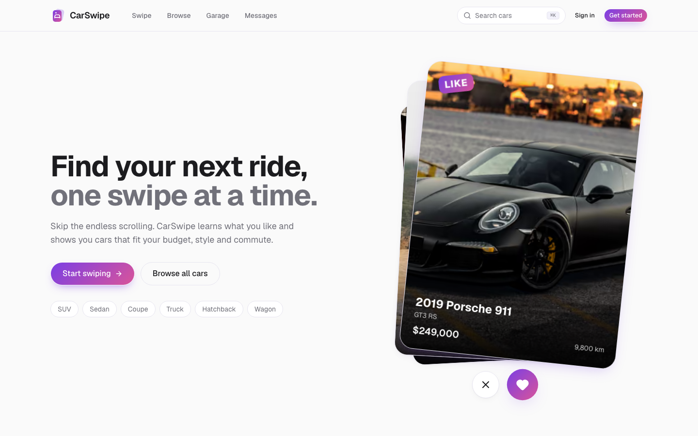

## Features

### For buyers

- **Swipe deck.** Drag or flick cards, use the buttons, or press ← / → (Z to undo). Every right swipe lands in your garage.
- **Personalised ranking.** Cars are scored on budget, brand, body style, year, mileage, distance and similarity to cars you liked, and cars you keep passing on are nudged down. See [how recommendations work](#how-recommendations-work).
- **Swipe before signing up.** Guest swipes are kept on the device and imported into the account when you sign in.
- **Browse and search.** Keyword search across make, model, trim, city, colour and engine, filters for price, make, body, year, mileage, transmission, fuel, drivetrain, condition, seller type and distance, and five sort orders. All filter state lives in the URL, so searches can be shared.
- **My Garage.** Saved cars with search, a body-style filter and sorting, plus recently viewed cars.
- **Compare.** Up to four cars side by side, with the best price, year, mileage and horsepower marked.
- **Messaging.** One conversation per buyer per listing, with unread badges, read receipts and new messages arriving without a refresh.
- **Seller ratings.** 1–5 star reviews. Only buyers who have messaged a seller can rate them, which keeps out drive-by ratings.

### For sellers

- **Listing form.** Drag-and-drop photos (up to 20) with a cover photo and reordering, drafts, publishing and editing. Validation messages are written for people.
- **Photo privacy.** Every upload is decoded, auto-rotated, resized and re-encoded to WebP on the server, which removes EXIF data such as GPS coordinates.
- **Seller dashboard.** Views, saves and inquiries, a 14-day views chart (with a table view) and per-listing actions: edit, mark pending or sold, relist, unpublish and delete.

### Everywhere

- Light and dark themes, a mobile bottom nav, ⌘K search and a notification bell.
- Keyboard and screen-reader support: labelled controls, focus rings, live regions, and reduced-motion support (the animated landing deck stays still).

## Screenshots

| Swipe | Browse |
| :---: | :---: |
| 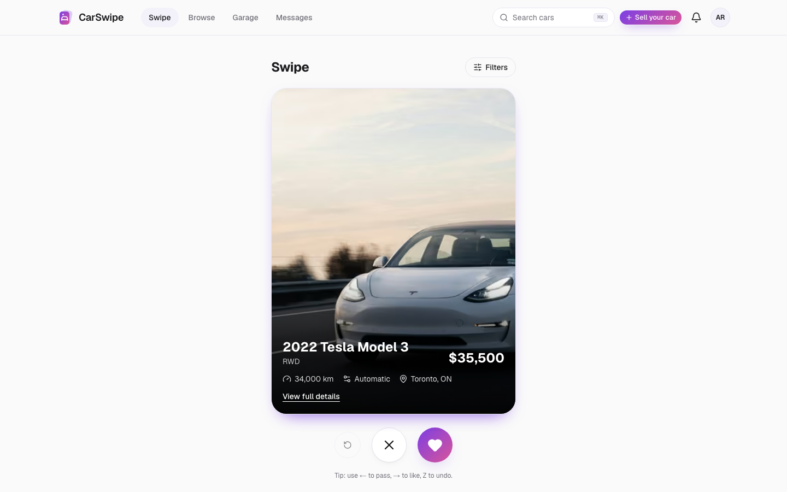 | 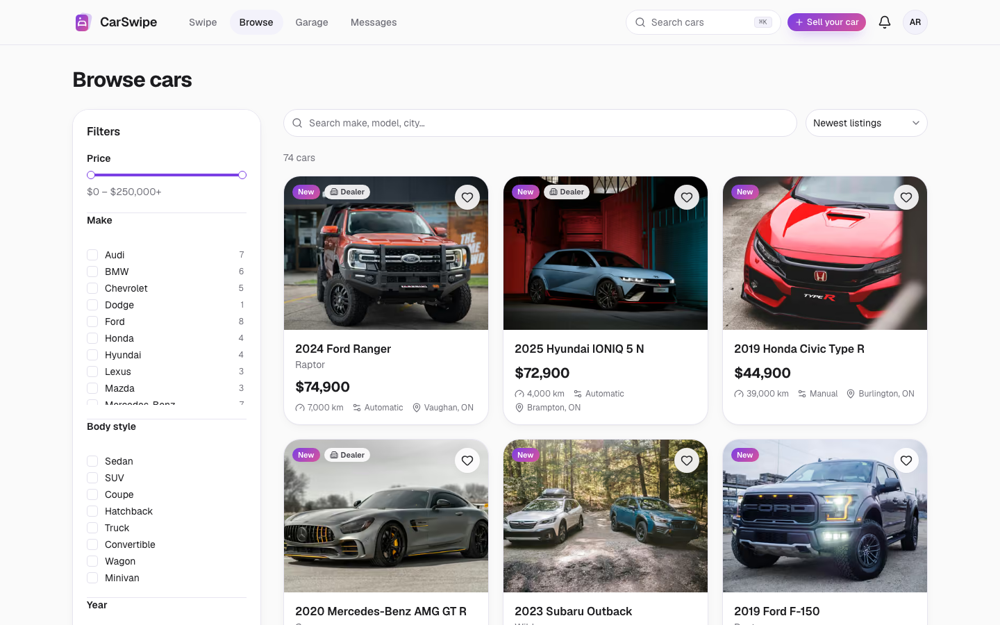 |
| **Listing** | **Seller reviews** |
| 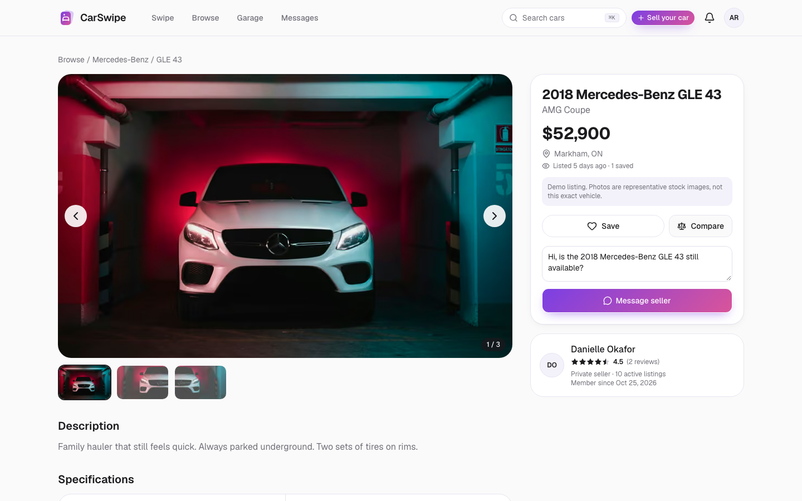 | 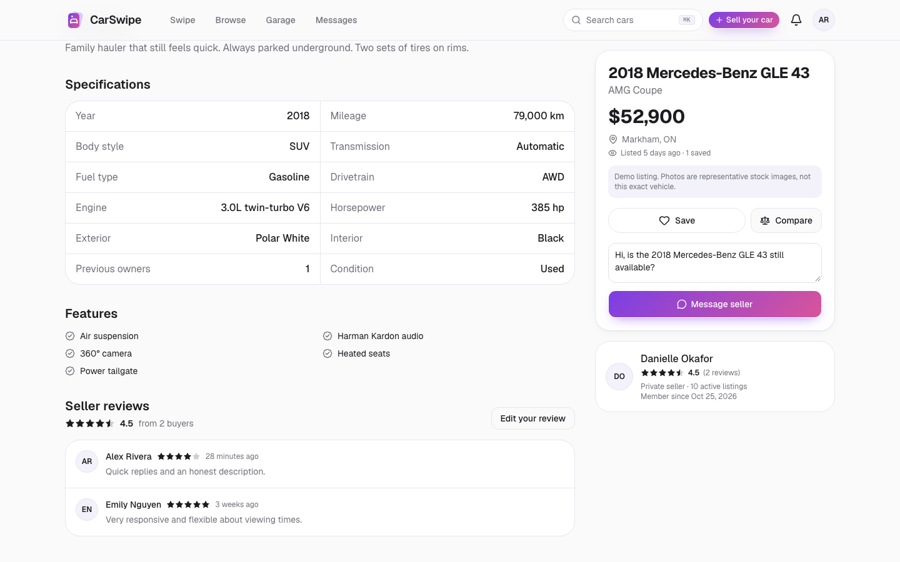 |
| **Compare** | **My Garage** |
| 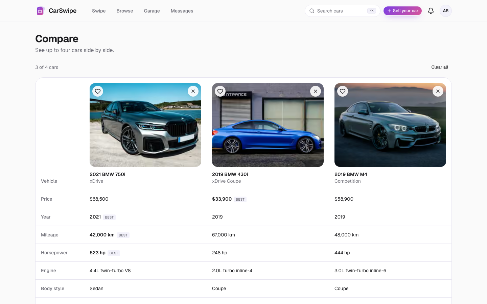 | 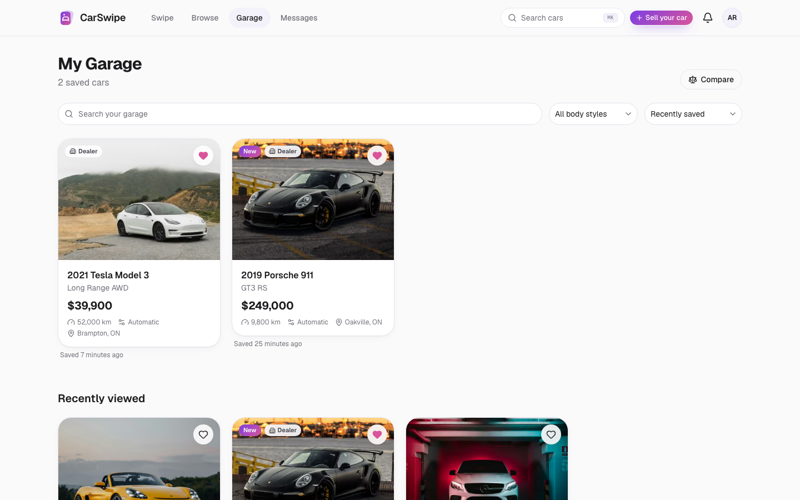 |
| **Messages** | **Seller dashboard** |
| 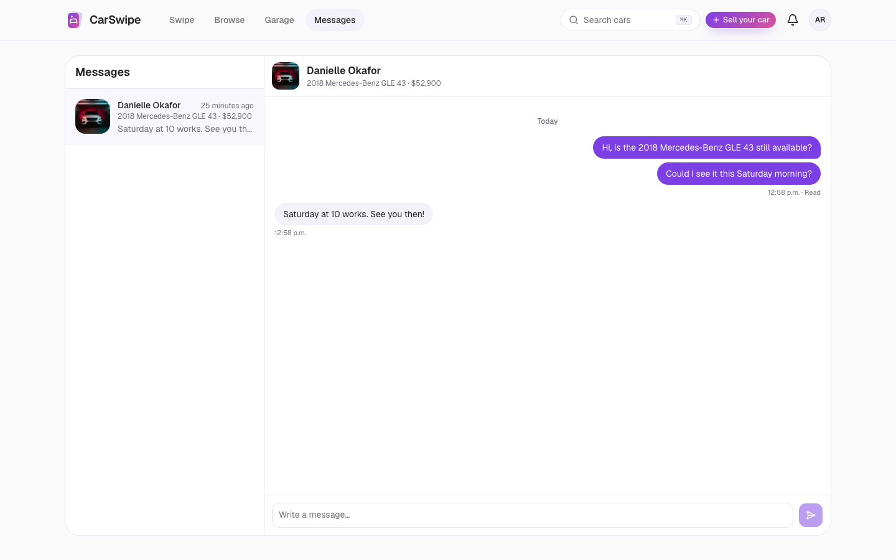 | 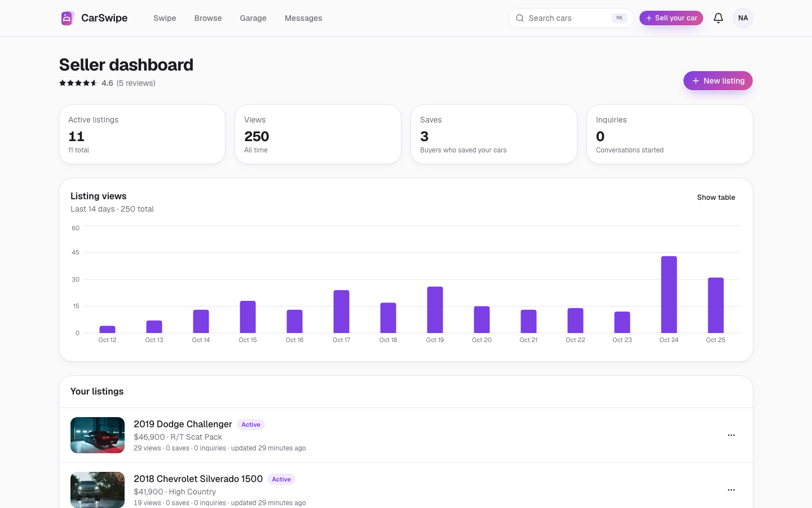 |
| **Sell your car** | |
| 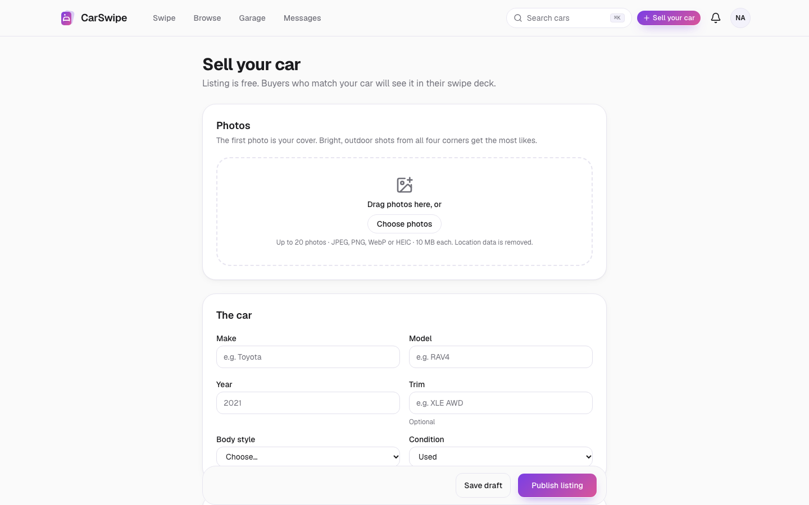 | |

<p align="center">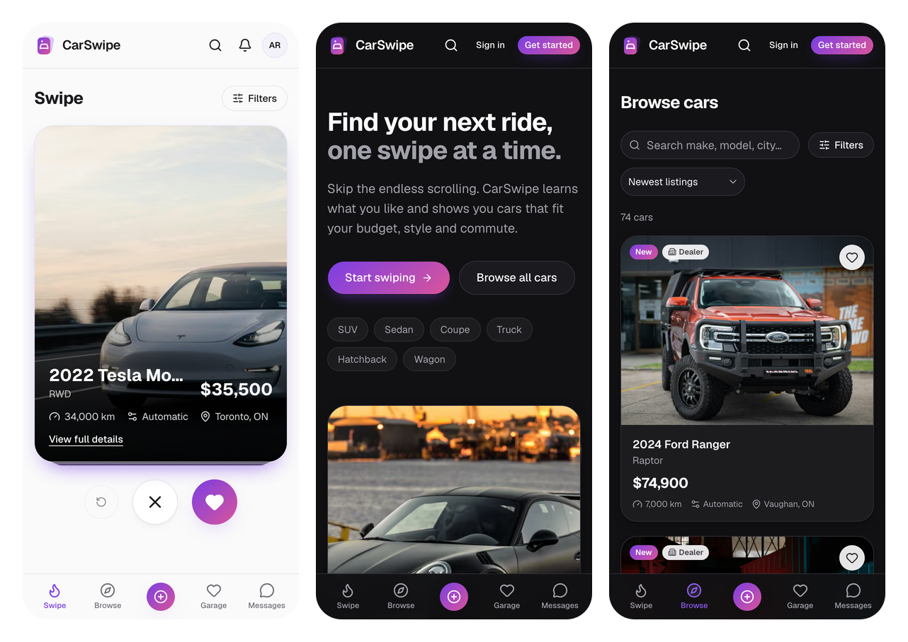</p>

## Getting started

### Prerequisites

- **Node.js 20.9+** and **pnpm** (`corepack enable`)
- **PostgreSQL 14+**. On macOS: `brew install postgresql@17 && brew services start postgresql@17`

### Setup

```bash
git clone https://github.com/AhmadHassan2/CarSwipe.git
cd CarSwipe
pnpm install                  # also generates the Prisma client

createdb carswipe             # create the database
cp .env.example .env          # then set DATABASE_URL and AUTH_SECRET (see below)

pnpm db:migrate               # create the tables
pnpm db:seed                  # load demo cars, sellers, reviews and view history
pnpm dev                      # http://localhost:3000
```

### Environment variables

| Variable | Required | Description |
| --- | :---: | --- |
| `DATABASE_URL` | ✓ | Postgres connection string, e.g. `postgresql://you@localhost:5432/carswipe` (Homebrew Postgres needs no password for your OS user) |
| `AUTH_SECRET` | ✓ | Session-signing secret. Generate one with `openssl rand -base64 32` |
| `AUTH_TRUST_HOST` | ✓ | `true` for local development and most hosts |
| `NEXT_PUBLIC_APP_URL` | ✓ | Public base URL, e.g. `http://localhost:3000` |
| `AUTH_GOOGLE_ID` / `AUTH_GOOGLE_SECRET` | | Enables "Continue with Google". The button is hidden when these are blank |

### Demo accounts

All demo accounts use the password **`CarSwipe123`**.

| Account | Email | What to try |
| --- | --- | --- |
| Buyer | `demo@carswipe.dev` | Pre-set preferences (BMW, Porsche or Tesla under $80k near Toronto). Swipe, save, compare, message |
| Dealer | `sales@northline.demo` | Seller dashboard with 14 days of views, ratings and 11 listings |
| Private seller | `priya@carswipe.dev` | A smaller seller account for trying the listing form |

Other sellers: `hello@lakeshore.demo`, `info@peelpremium.demo`, `team@steeltown.demo`, `marcus@carswipe.dev`, `danielle@carswipe.dev` and `liam@carswipe.dev`.

> Demo listings use free [Unsplash](https://unsplash.com/license) photos of the same make and model. They're representative stock images, not the actual car, and each demo listing says so.

## Scripts

| Command | What it does |
| --- | --- |
| `pnpm dev` | Start the dev server (Turbopack) |
| `pnpm build` / `pnpm start` | Production build and server |
| `pnpm lint` | ESLint |
| `pnpm typecheck` | TypeScript, no emit |
| `pnpm test` | Unit tests (Vitest) |
| `pnpm db:migrate` | Create and apply migrations in development |
| `pnpm db:deploy` | Apply migrations in production |
| `pnpm db:seed` | Reset demo data. Only demo users and listings are replaced, so real accounts survive |
| `pnpm db:reset` | Drop everything, re-migrate and re-seed |
| `pnpm db:studio` | Browse the database in Prisma Studio |

## Tech stack

| Area | Choice |
| --- | --- |
| Framework | Next.js 16 (App Router, Server Components, Server Actions, Turbopack), React 19 |
| Language | TypeScript (strict) |
| Database | PostgreSQL with Prisma 7 (driver adapter `@prisma/adapter-pg`) |
| Auth | Auth.js v5: email and password (bcrypt) plus optional Google OAuth, with JWT sessions |
| UI | Tailwind CSS 4, shadcn/ui on Radix primitives, lucide icons, Motion for animation |
| Client state | TanStack Query (server data), Zustand (saved IDs, compare list, guest swipes) |
| Forms and validation | React Hook Form and Zod, with schemas shared between client and server |
| Images | `next/image`, with `sharp` for upload processing |
| Charts | Recharts |
| Testing | Vitest |

## Project structure

```
prisma/
  schema.prisma           data model (15 models)
  migrations/             SQL migrations
  seed.ts, seed-data/     demo cars, sellers, reviews and view history
src/
  app/
    (site)/               pages with the main header, footer and mobile nav
    (auth)/               login, signup and onboarding (minimal layout)
    api/                  route handlers (JSON APIs)
    actions/              server actions (auth, messages, account, preferences)
  components/             UI by feature (swipe, browse, sell, messages…) plus ui/ (shadcn)
  features/               pure logic shared by client and server: filters, schemas, scoring
  server/
    services/             business logic and database access, server-only
    storage/              image processing and storage
    auth.ts, db.ts, api.ts, rate-limit.ts
  store/                  Zustand stores
  proxy.ts                route protection (Next 16's replacement for middleware)
tests/unit/               Vitest specs
docs/                     architecture notes and screenshots
```

More detail on the data model, request flow and API is in **[docs/ARCHITECTURE.md](docs/ARCHITECTURE.md)**.

## How recommendations work

The swipe deck ranks active listings with a deterministic, explainable scorer (`src/features/recommendations/score.ts`):

1. **Candidates.** Up to 250 active listings matching any filters, excluding cars the user has already swiped and their own listings.
2. **Scoring.** Each preference the user has set scores 0–1, then the scores are combined with weights:

   | Signal | Weight | How it's scored |
   | --- | ---: | --- |
   | Budget | 30% | 1 inside the range, falling off softly to 0 at 20% over |
   | Brand | 20% | Matches a preferred make |
   | Body style | 15% | Matches a preferred body style |
   | Year | 10% | Inside the range, falling off over 4 years |
   | Mileage | 10% | Under the maximum, falling off over the next 50% |
   | Location | 10% | Within the radius, falling off over another radius |
   | Similarity | 5% | Same make, body style or price band as recent likes |

   Preferences the user hasn't set are left out, and the remaining weights are re-normalised.
3. **Prior.** A recency and popularity score (how new the listing is and how often it's been saved) breaks ties and ranks everything for brand-new users.
4. **Pass penalty.** Makes the user has passed on three or more times are gently down-ranked.

The scorer is a pure function, so it is unit-tested and could be swapped for a learned model behind the same interface.

## Security and privacy

- Passwords are hashed with bcrypt (cost 12). Failed logins take the same time whether or not the email exists, so accounts can't be discovered by timing.
- Every write is checked on the server for ownership. Another user's listing or conversation returns **404**, not 403, so IDs can't be probed.
- Zod validates every API and server-action input. Unexpected errors return a generic message and are logged without request bodies.
- Rate limits cover login, signup, messages, uploads, swipes, reviews and password changes.
- Post-login redirects only go to same-site paths.
- Uploads are validated by decoding the image (not by extension) and re-encoded, which removes EXIF and GPS data. A listing can only use photos its owner uploaded.
- The app sends security headers: a Content-Security-Policy, `X-Frame-Options: DENY`, `nosniff`, a strict referrer policy and HSTS in production.

## Testing

```bash
pnpm test        # 16 unit tests: listing validation, filter parsing, redirects, recommendation scoring
pnpm lint && pnpm typecheck
```

Each feature was also tested end to end in a real browser during development, including two-user messaging, photo upload with GPS removal, and ownership checks. Committing those as a Playwright suite is on the roadmap.

## Roadmap and known limitations

- **Image storage** is local disk (`public/uploads`), which suits local and single-server deploys. Serverless hosts need object storage (S3, Cloudinary), and `src/server/storage/images.ts` is the only file to change.
- **Rate limiting** is in memory and per instance. Use Redis or Upstash when running more than one server.
- **Messaging** polls every 4 seconds. Server-sent events or websockets would make it instant.
- **Not built yet:** password reset and email verification (these need an email provider), reporting a listing (the database table exists), public seller pages, price-drop alerts and a committed Playwright suite.
